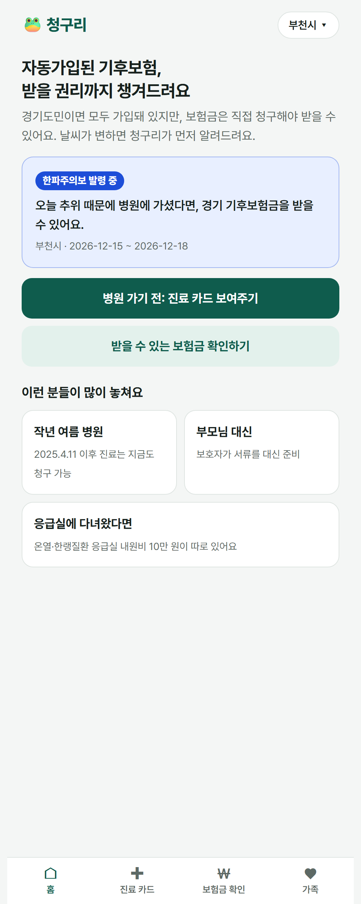
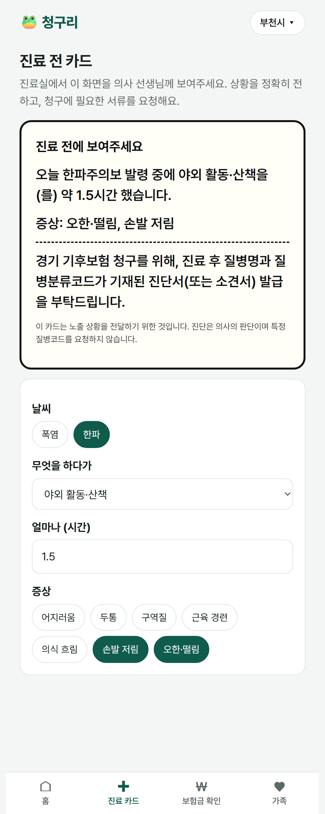
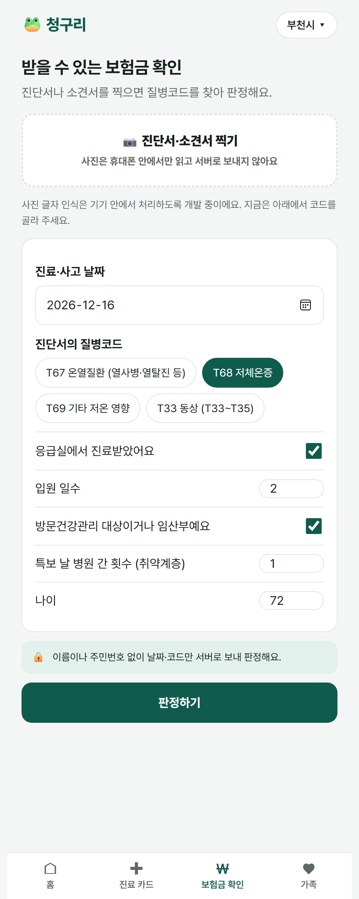
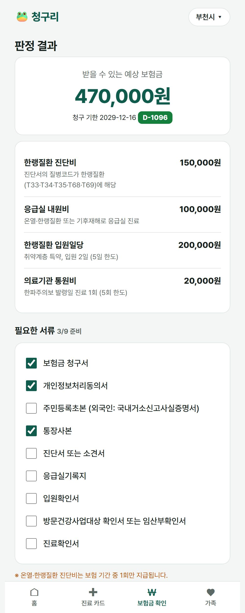
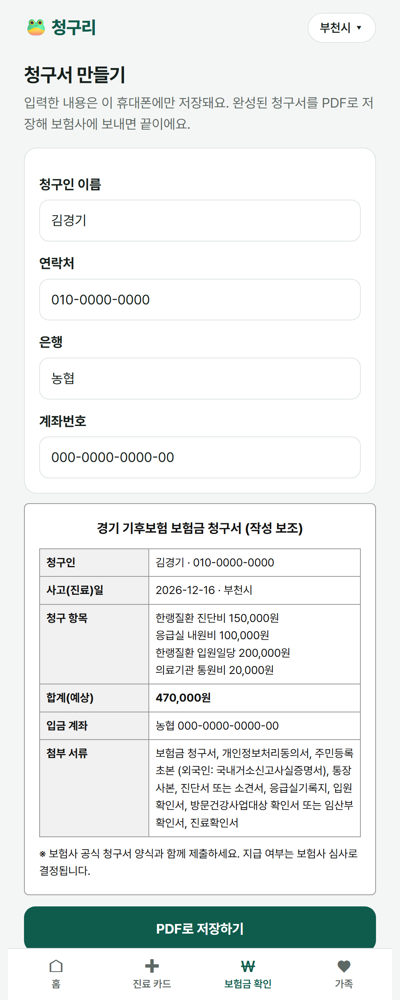
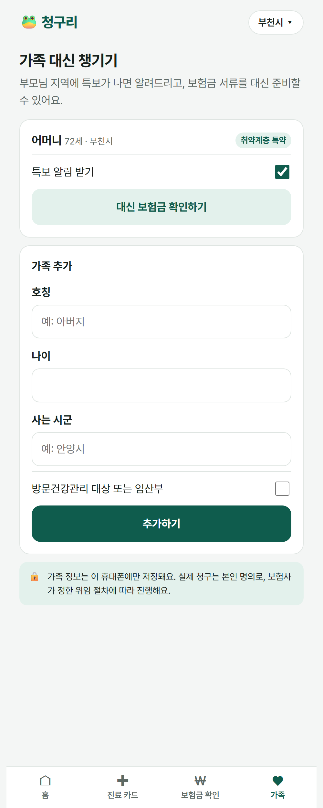

# 청구리 — 경기 기후보험 '받을 권리' 청구 에이전트

**2026 컴퓨터정보공학부 학술제 CLUE DAY 1차 제출 서비스 기획안**

| 항목 | 내용 |
|---|---|
| 팀명 / 팀장 | 한라봉귤흑돼지 / 명지훈 |
| 주제 영역 | 지역사회 문제 해결 (환경·안전) + 사회 서비스 증진 (복지) |
| 한 줄 소개 | 자동가입된 경기 기후보험, **받을 권리까지** 챙겨주는 청구 도우미 |
| 이름의 뜻 | 보험금 **청구** + 비 오기 전에 우는 **청개구리**. 날씨가 변하면 먼저 알려주는 청구 도우미 |
| 형태 | 모바일 웹(PWA) + REST API |
| 현재 구현 | API 6개 동작 · 화면 6개 · 자동 테스트 5개 통과 |

---

## 1. 문제 정의

### 1-1. 가입은 자동인데, 청구는 수동이다

경기도는 2025년부터 모든 도민을 **경기 기후보험**에 자동 가입시키고 보험료를 전액 부담합니다. 2026년(보험기간 2026.4.11 ~ 2027.4.10)에는 보장이 크게 늘었습니다.[^1]

| 보장 | 금액 | 조건 |
|---|---|---|
| 온열·한랭질환 진단비 | 15만 원 (2025년 10만 원에서 인상) | 질병코드 T67 / T33·T34·T35·T68·T69 진단 |
| 응급실 내원비 (신설) | 10만 원 | 온열·한랭질환 또는 기후재해로 응급실 진료 |
| 사망위로금 (신설) | 300만 원 | 온열·한랭질환 또는 기후재해로 사망 (만 15세 미만 제외) |
| 기후재해 사고 위로금 | 30만 원 | **기후특보 발령일** 사고로 4주 이상 진단 |
| 취약계층 통원비 | 2만 원 × 5회 | **기상특보 발령일** 진료 (방문건강관리 대상·임산부) |
| 취약계층 입원일당 | 10만 원 × 5일 | 온열·한랭질환 입원 |

하지만 **보험금은 자동으로 나오지 않습니다.** 본인이 청구서, 개인정보처리동의서, 주민등록초본, 통장사본에 진단서·소견서·응급실기록지 등을 갖춰 보험사(메리츠화재)에 직접 보내야 합니다.[^1]

### 1-2. 어디서 놓치는가 (근거)

1. **진료 순간에 놓친다.** 진단서·소견서에 온열·한랭질환 질병코드가 있어야 청구됩니다. 그런데 보험이 있는 줄 모르면 영수증만 받고 나와, 나중에 서류를 떼러 병원을 다시 찾아야 합니다.
2. **조건을 스스로 판단하기 어렵다.** 통원비와 기후재해 위로금은 '그날 우리 지역에 기상특보가 발령됐는가'에 달려 있는데, 개인이 지난 특보 이력을 확인하기는 어렵습니다.
3. **서류 작성이 어렵다.** 안양시가 구청에서 '찾아가는 기후보험 청구의 날'을 열자 이틀 동안 **268명이 찾아와 225건**을 접수했습니다(2026.9.29~30). 도움이 있으면 청구하는 사람이 많다는 뜻입니다.[^2]
4. **실제 규모.** 2025년 경기 기후보험 온열질환 진단비 지급은 **655건**이었습니다.[^3] 같은 해 질병관리청 응급실 감시체계에 신고된 경기도 온열질환자만 **978명**(전국 1위)입니다.[^4] 응급실 집계에는 동네 의원 진료가 빠져 있어, 실제 보장 대상자는 이보다 많습니다. 2026년에는 진단비 인상과 홍보로 10월 21일까지 **1,472건**이 지급됐지만,[^3] 여전히 오프라인 지원 창구에 사람이 몰립니다.

> 같은 문제는 다른 '자동가입 보험'에도 있습니다. 서울시민안전보험은 2026년 계약액 25억 2,200만 원 중 실제 지급이 8억 500만 원(32%)에 그쳤다는 지적이 나왔습니다.[^5]

### 1-3. 누구의 문제인가

- **어르신·기후취약계층** (방문건강관리 대상 + 임산부, 약 22만 명[^6]): 서류 준비가 가장 어렵고 보장은 가장 넓습니다.
- **야외 노동자·청년**: 폭염·한파에 가장 많이 노출되지만 보험의 존재를 모릅니다.
- **보건소·방문건강관리 인력**: 대상자의 청구를 하나하나 도와야 해서 업무 부담이 큽니다.

---

## 2. 솔루션: 청구리

**사건(특보·진료)을 계기로 보장 대상인지 감지하고, 진료 전부터 청구 서류가 완성될 때까지 함께 갑니다.**

<div class="screens">
<figure><figcaption>① 홈·특보</figcaption></figure>
<figure><figcaption>② 진료 카드</figcaption></figure>
<figure><figcaption>③ 보험금 확인</figcaption></figure>
<figure><figcaption>④ 판정 결과</figcaption></figure>
<figure><figcaption>⑤ 청구서</figcaption></figure>
<figure><figcaption>⑥ 가족</figcaption></figure>
</div>

| 단계 | 기능 | 화면 |
|---|---|---|
| ① 특보 감지 | 내 지역(또는 부모님 지역)에 폭염·한파 특보가 발령되면 "오늘 병원에 갔다면 보험금 대상일 수 있어요" 알림 | 홈 |
| ② 진료 전 카드 | 진료실에서 보여줄 큰 글씨 카드. **노출 상황(무엇을, 몇 시간, 어떤 증상)을 정확히 전달하고, 청구용 진단서(또는 소견서) 발급을 요청** | 진료 카드 |
| ③ 보장 판정 | 질병코드·날짜·응급실·입원 여부로 받을 수 있는 항목과 금액, 근거, 청구 기한(D-day) 판정. 특보 이력과 자동 대조 | 보험금 확인 → 결과 |
| ④ 서류 체크리스트 | 판정된 항목에 맞춰 필요한 서류만 골라 체크리스트로 제공 | 결과 |
| ⑤ 청구서 완성 | 청구서 작성 보조본을 기기에서 PDF로 저장, 접수 채널(카카오톡 채널·팩스·이메일·우편) 안내 | 청구서 |
| ⑥ 보호자 모드 | 부모님 지역 특보 알림, 부모님 조건(취약계층·나이)으로 대신 판정·서류 준비 | 가족 |

**확장**: 보장표와 판정 규칙을 데이터로 분리해, 시군 시민안전보험처럼 '자동가입인데 사람들이 모르는' 다른 제도를 같은 엔진으로 추가합니다.

---

## 3. 설계 원칙 (신뢰·윤리·개인정보)

| 원칙 | 구현 |
|---|---|
| **진단은 의사의 몫** | 진료 카드는 노출 상황을 전달하고 '청구용 진단서 발급'을 요청할 뿐, **특정 질병코드를 요구하지 않습니다.** 카드에 이 문구를 명시하고, 자동 테스트로 카드 문구에 질병코드가 들어가지 않음을 검증합니다. |
| **데이터 최소화** | 서버는 날짜·시군·질병코드·체크 항목만 받아 판정하고 **저장하지 않습니다.** 이름·연락처·계좌·가족 정보는 기기(localStorage)에만 저장합니다. |
| **사진은 기기 밖으로 나가지 않음** | 진단서 사진의 글자 인식은 휴대폰 안에서 처리합니다 (2차 개발). 건강정보는 민감정보이므로 서버 전송 자체를 없애는 설계입니다. |
| **판정은 '예상'** | 모든 결과에 "최종 지급은 보험사 심사로 결정" 안내. 보험금 청구 자체는 본인(또는 보험사가 정한 위임 절차의 대리인)이 합니다. |
| **시민 무료** | 시민에게는 어떤 수수료도 받지 않습니다. |

---

## 4. 차별성 (창의성)

| 비교 대상 | 하는 일 | 청구리가 다른 점 |
|---|---|---|
| 카카오톡 '경기 기후보험' 채널 | 서류 사진을 올려 **접수** | 접수 **이전**(특보 감지, 진료 전 카드, 보장 판정, 서류 준비)을 책임집니다. 접수는 기존 채널로 연결 |
| 찾아가는 청구의 날 (시군) | 이틀간 오프라인 서류 작성 지원 | 상시·비대면, 보호자 원격 지원, 기관 대시보드로 오프라인 지원을 보완 |
| 일반 보험 청구 앱 | 사용자가 '청구하겠다'고 한 뒤 서류 접수 | **사건 기반 감지**: 특보 발령과 진료를 계기로 먼저 알려줌 |
| 정부 혜택 알림 서비스 | 받을 수 있는 혜택 목록 안내 | 특보 이력 대조, 질병코드 판정, 진료 시점 개입까지 **청구 완결**에 집중 |

**핵심 아이디어**: 보험 약관에 있는 '기상특보 발령일' 조건을 공공 기상 데이터와 연결해, 개인이 알 수 없던 보장(통원비·기후재해 위로금)을 자동으로 찾아 줍니다.

---

## 5. 실행력

### 5-1. 현재 구현 (1차 제출 시점, 레포지토리에서 바로 실행 가능)

- **백엔드** (Python · FastAPI): `/api/health`, `/api/coverages`, `/api/alerts`, `/api/eligibility`, `/api/doctor-card`, `/api/claim-channels` 동작. 자동 테스트 5개 통과 (온열 진단+응급실 판정, 취약계층 통원비 특보 조건·5회 한도, 2025년 약관 구분, 진료 카드 코드 미요청).
- **프론트엔드** (HTML/CSS/JS 모바일 웹): 홈, 진료 카드, 보험금 확인, 판정 결과, 청구서, 가족 6개 화면이 실제 API와 연동.
- **데이터**: 2026 경기 기후보험 보장표·청구 서류·접수 채널을 경기도 공식 안내에서 구조화.

### 5-2. 구조

```
[휴대폰]  모바일 웹(PWA)
  ├─ 기기 저장: 이름·계좌·가족 정보, 청구서 PDF, (2차) 진단서 사진 글자 인식
  └─ 서버로 보내는 것: 날짜·시군·질병코드·체크 항목 (저장 안 함)
        │
[서버]  FastAPI ── 보장표·판정 규칙 (데이터로 분리)
        └─ 기상특보: 1차 샘플 → 2차 기상청 특보 오픈API
[기관용, 2차]  보건소 대시보드 ── 대상자별 '청구 진행 단계'만 관리 (진단 내용·서류 원본 없음)
```

### 5-3. 일정 (최종 제출 11/16, 시연 11/24)

| 기간 | 할 일 | 검증 |
|---|---|---|
| ~10/26 | MVP: API 6개, 화면 6개, 테스트 | 1차 제출 |
| 10/27 ~ 11/2 | 사용자 인터뷰: 어르신·보호자 5명, 보건소 방문건강관리 담당자 1~2명 | 불편 지점·문구 검증 |
| 11/3 ~ 11/9 | 기상청 특보 오픈API 연동, 기기 내 글자 인식(질병코드 추출), PWA 푸시 | 실제 특보로 알림 동작 |
| 11/10 ~ 11/16 | 기관용 대시보드, 접근성(큰 글씨·음성 안내), 사용성 테스트 10명 | 서류 준비 완료율·소요 시간 측정 |
| 11/24 | 시연: "한파주의보 날, 72세 어머니의 응급실 진료 → 47만 원 청구서 완성" | 라이브 데모 |

### 5-4. 팀 역할

| 역할 | 담당 |
|---|---|
| 팀장·총괄 | 명지훈 |
| 기획·사용자 조사 | 박정민 |
| 백엔드 (판정 엔진·특보 연동) | 김동건 |
| 프론트엔드 (모바일 웹·접근성) | 고건 |
| 디자인 (UI/UX·마스코트) | 천세훈, 노경민, 정지인 |

---

## 6. 지속 가능성과 수익 모델

### 6-1. 누가, 왜 비용을 내는가

| 주체 | 얻는 것 | 방식 |
|---|---|---|
| 시민 | 받을 보험금 | **무료** |
| 경기도 (기후보험 주관 부서) | 정책 실효성(보장 도달률) 향상 — 도가 보험료를 전액 내는 만큼 '도민이 실제로 받는 것'이 성과 | 위탁 운영·공식 채택 |
| 시군 보건소 (방문건강관리) | 대상자 청구 지원 업무 효율화, '찾아가는 청구의 날'의 상시화 | **기관용 대시보드 라이선스** (B2G) |
| 다른 지자체 | 시민안전보험·정책보험의 낮은 활용률 개선 | 같은 엔진에 보장표만 추가해 확장 |

- **시장 크기**: 경기도 31개 시군 보건소에서 시작해, 대부분의 시군이 운영하는 자동가입 시민안전보험[^7]과 제주 등 다른 시도의 정책성 기후보험[^8]으로 넓힐 수 있습니다.
- **운영 비용이 낮음**: 판정은 규칙 기반이고 개인정보를 저장하지 않아, 서버·보안 비용이 작습니다.
- **보험사 수수료는 받지 않습니다.** 보험료는 경기도가 내고, 청구가 늘면 보험사의 지급액이 늘어나 이해관계가 맞지 않기 때문입니다. 다만 서류가 갖춰진 청구는 반려와 재요청을 줄여 보험사와 도의 행정 부담을 덜어 줍니다.

### 6-2. 성과 지표

| 지표 | 의미 |
|---|---|
| 판정 → 청구서 완성 전환율 | 서비스가 실제 청구까지 이어지는가 |
| 서류 준비 완료율·소요 시간 | 서류 장벽을 얼마나 낮췄는가 |
| 특보 알림 → 진료 카드 사용률 | 진료 시점 개입이 작동하는가 |
| 보호자·기관 대리 지원 건수 | 취약계층에 닿고 있는가 |

---

## 7. 기대 효과

- **도민**: 자동가입된 보험을 실제 보장으로 바꿉니다. 특히 서류가 어려운 어르신과 야외 노동자.
- **지자체**: 보험료를 쓴 만큼 도민이 혜택을 받게 되고, 오프라인 청구 지원 부담이 줄어듭니다.
- **지역**: 대학생이 만든 기술로 경기도 정책의 실효성을 높이는 RISE형 지역 기여 사례가 됩니다.[^9]

## 8. 위험과 대응

| 위험 | 대응 |
|---|---|
| 경기도가 자동 지급·간편 청구를 도입 | 경쟁이 아니라 **도가 채택할 수 있는 도구**로 설계 (기관 대시보드, 보장표 데이터화). 진료 시점 개입·특보 대조는 자동 지급과도 보완 관계 |
| 약관·보장 금액 변경 | 보장표를 데이터로 분리해 연 1회 갱신. 공식 문서 간 금액 차이(진단비 15만/20만 원)는 도에 확인 후 반영 |
| 건강정보 처리 | 사진·진단 내용은 기기 안에서만 처리, 서버 무저장, 기관용은 진행 단계만 |
| 계절성 | 폭염(여름)·한파(겨울)·감염병(연중) 보장을 모두 다뤄 연중 사용 |
| 잘못된 판정 | '예상 판정' 고지, 근거 표시, 보험사 콜센터 연결 |

---

[^1]: 경기도 기후보험 안내(보장·청구 서류·접수 채널), https://www.gg.go.kr/gg_insure · 경향신문 2026.4.13, https://www.khan.co.kr/article/202604131038001/
[^2]: 메트로신문 2026.10.2 (안양시 찾아가는 경기 기후보험 청구의 날), https://www.metroseoul.co.kr/article/20261003500011
[^3]: 아시아뉴스통신 (경기 기후보험 온열질환 진단비 1,472건 지급, 전년 655건), https://www.anewsa.com/detail.php?number=3211301
[^4]: 경향신문 2025.10.16 (질병관리청 온열질환 응급실 감시체계, 경기 978명), https://www.khan.co.kr/article/202510161247001/
[^5]: 서울신문 2026.9.2 (서울시민안전보험 지급률 지적), https://m.go.seoul.co.kr/news/2026/09/02/20260902500030
[^6]: 2026년 경기 기후보험 시행 보도 (임산부 약 7만 명 편입, 기후취약계층 약 22만 명), 머니투데이 2026.4.13, https://www.mt.co.kr/policy/2026/04/13/2026041309252192981
[^7]: 예: 구리시 시민안전보험 (자동가입), https://www.guri.go.kr/www/contents.do?key=5342
[^8]: 뉴데일리 2026.8.6 (경기도·제주도 정책성 기후보험), https://biz.newdaily.co.kr/site/data/html/2026/08/06/2026080600099.html
[^9]: 가톨릭대 RISE사업단 부천 지역 거버넌스 협약, https://dhnews.co.kr/news/view/1065571488019515
